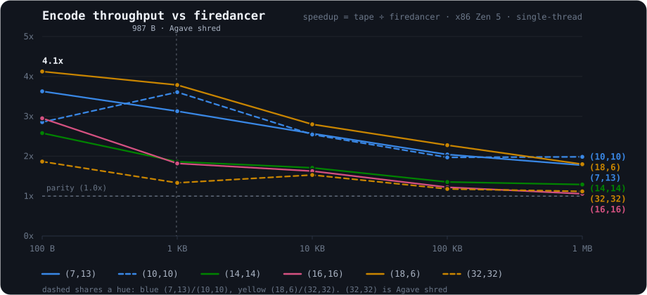

# Benchmarks

This document summarizes the current performance of `tape-reed-solomon`.
Historical experiments and superseded results are preserved in
[benches/NOTES.md](benches/NOTES.md).

The benchmarks measure data-payload throughput: `data shards × shard size`
divided by elapsed time. All published comparisons are single-threaded because
the production system parallelizes across independent stripes.



## Summary

- On AMD Zen 5, GF(2^8) encoding measured 1.06x to 4.12x the throughput of
  Firedancer across six shard shapes and five shard sizes.
- On Apple M-series, the NEON encoder measured 1.5x to 2.1x faster than its
  earlier fused-matrix path at the tested 10 KB shard size.
- In Node 24, the WebAssembly SIMD encoder measured 12x to 18x the scalar
  implementation across the tested per-plane range.
- On Apple M-series, reconstruction measured 1.6x to 3.6x the C-accelerated
  `reed-solomon-erasure` implementation in the reported cases.

These results are workload- and hardware-specific. Small differences should be
retested on the deployment hardware.

## GF(2^8) encoding

### AMD Zen 5

The headline comparison was measured on one AMD Zen 5 Turin core with GFNI and
AVX-512. Each cell is `tape-reed-solomon` throughput divided by Firedancer
throughput from the same run:

| shape `(data, parity)` | 100 B | 1 KB | 10 KB | 100 KB | 1 MB |
|---|---:|---:|---:|---:|---:|
| (7,13) | 3.63x | 3.13x | 2.57x | 2.04x | 1.77x |
| (10,10) | 2.85x | 3.61x | 2.54x | 1.97x | 1.98x |
| (14,14) | 2.58x | 1.86x | 1.71x | 1.35x | 1.29x |
| (16,16) | 2.95x | 1.82x | 1.63x | 1.22x | 1.06x |
| (18,6) | 4.12x | 3.78x | 2.80x | 2.28x | 1.80x |
| (32,32) | 1.87x | 1.33x | 1.53x | 1.18x | 1.12x |

The advantage narrows for large shards as both implementations become limited
by memory bandwidth.

### Apple M-series

Single-thread encode throughput at a 10 KB shard size:

| shape `(data, parity)` | route | MiB/s |
|---|---|---:|
| (7,13) | generated FFT | 10,433 |
| (10,10) | generated FFT | 13,947 |
| (14,14) | generated FFT | 9,735 |
| (16,16) | staged FFT | 5,588 |

These routes measured 1.5x to 2.1x faster than the earlier fused-matrix encoder
and led both native comparison implementations in the corresponding run.

### WebAssembly

With SIMD128 enabled under Node 24, representative encode results were:

| shape `(data, parity)` | MiB/s |
|---|---:|
| (7,13) | 4,866 |
| (10,10) | 7,087 |
| (16,16) | 6,343 |

Across the tested per-plane range, the SIMD path measured 12x to 18x the scalar
implementation. Browser and JavaScript-engine behavior may differ from Node.

## GF(2^8) reconstruction

The following results were measured on an Apple M-series CPU against
`reed-solomon-erasure` with its C SIMD backend. `prepared` uses a decoder built
once for a repeated erasure pattern.

One missing data shard:

| shape | shard size | reference | tape | prepared |
|---|---:|---:|---:|---:|
| (7,13) | 10 KB | 19,478 | 33,964 (1.7x) | 32,102 (1.6x) |
| (7,13) | 1 MB | 19,858 | 35,363 (1.8x) | 35,391 (1.8x) |
| (10,10) | 10 KB | 19,304 | 39,287 (2.0x) | 38,495 (2.0x) |
| (10,10) | 1 MB | 20,069 | 31,902 (1.6x) | 32,431 (1.6x) |

Maximum recoverable loss:

| shape | shard size | reference | tape | prepared |
|---|---:|---:|---:|---:|
| (7,13) | 1 KB | 1,446 | 4,314 (3.0x) | 4,359 (3.0x) |
| (7,13) | 10 KB | 1,529 | 4,731 (3.1x) | 4,716 (3.1x) |
| (7,13) | 1 MB | 1,548 | 3,813 (2.5x) | 4,044 (2.6x) |
| (10,10) | 1 KB | 1,878 | 6,385 (3.4x) | 6,452 (3.4x) |
| (10,10) | 10 KB | 1,969 | 7,118 (3.6x) | 7,024 (3.6x) |
| (10,10) | 1 MB | 2,019 | 5,439 (2.7x) | 5,281 (2.6x) |

All throughput values are MiB/s of data payload. The regular reconstruction
path closely tracks the explicitly prepared path because the codec caches
decode plans by erasure pattern.

## GF(2^16)

The repository includes a separate GF(2^16) harness comparing `ReedSolomon16`
with `reed-solomon-simd` across production-scale shapes. A stable, named-hardware
result set has not yet been promoted into this document.

Run the harness with:

```sh
cargo run --release --manifest-path benches/gf16-bench/Cargo.toml
```

This gap is intentional: unpublished local measurements should not be presented
as portable benchmark claims.

## Methodology

- Every comparison uses one thread. Competing implementations have internal
  thread pools disabled where applicable.
- Native `reed-solomon-erasure` results enable its `simd-accel` feature, so the
  baseline is its production C SIMD implementation rather than scalar Rust.
- Firedancer, `sia_reed_solomon`, and `tape-reed-solomon` are checked for
  compatible parity before timing where they share a wire format.
- Benchmark inputs are allocated before timing. Throughput includes encoding or
  reconstruction work, but not application-level I/O.
- The harness warms each implementation before measuring a timed loop. Published
  tables are snapshots from named runs, not statistical confidence intervals.
- Runtime dispatch selects the backend supported by the machine executing the
  benchmark.

## Reproducing the results

Run the native comparison harness on the current machine:

```sh
cargo run --release --manifest-path benches/bench-harness/Cargo.toml
```

Run the Firedancer comparison on an x86-64 machine with the required SIMD
features and build tools:

```sh
bash benches/fd-bench/run.sh
```

Build and run the WebAssembly SIMD harness:

```sh
RUSTFLAGS="-C target-feature=+simd128" \
  wasm-pack build benches/wasm-bench --target nodejs --release
node benches/wasm-bench/run.mjs
```

Benchmark code lives under [`benches/`](benches/). Run correctness tests before
recording results from a new architecture:

```sh
cargo test --release
```
